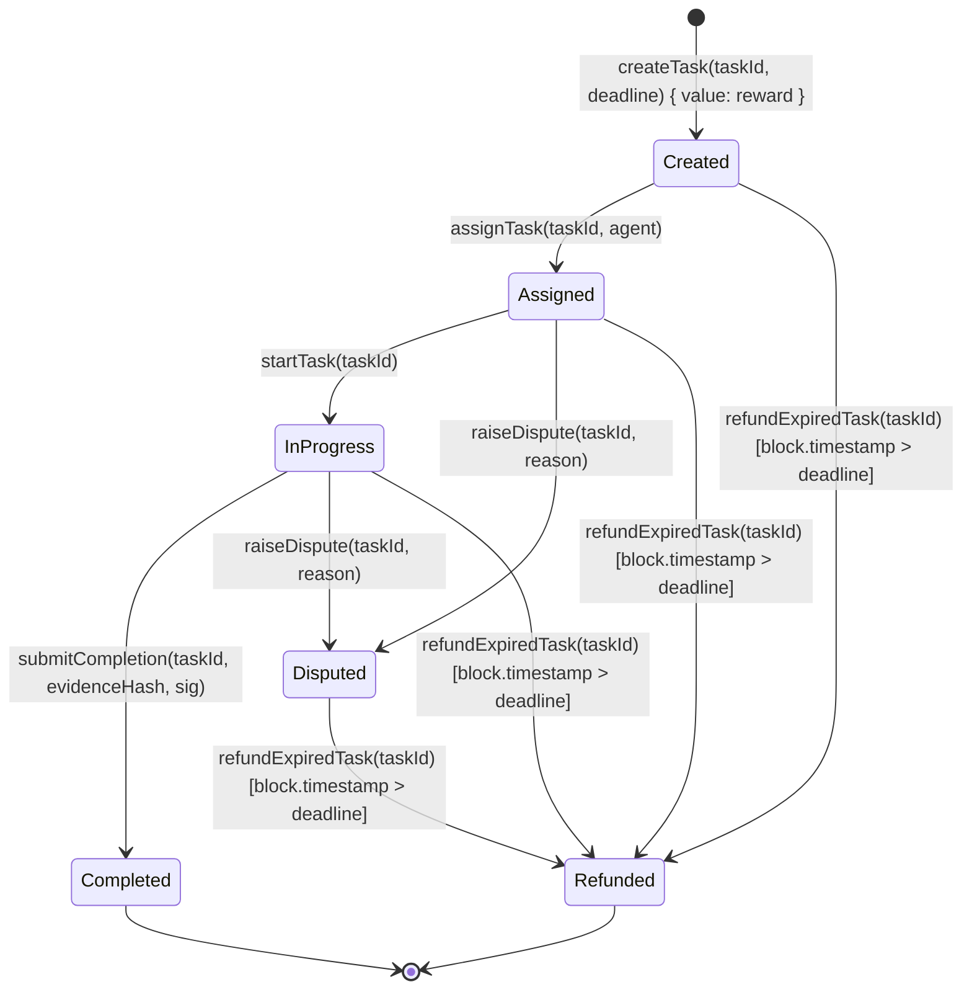
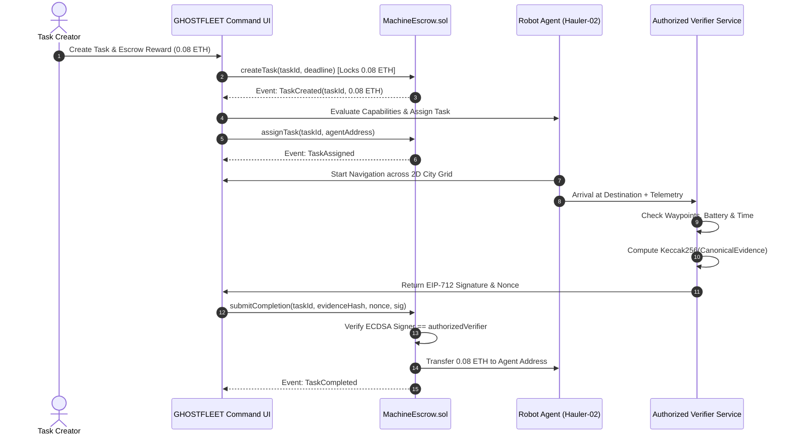

# GHOSTFLEET SYSTEM ARCHITECTURE & CONTRACT DESIGN

## 1. System Architecture Diagram

```mermaid
flowchart TD
    subgraph Frontend["GHOSTFLEET Web Application (React + Vite + Tailwind)"]
        UI[Command Center & 2D City Grid]
        Store[FleetContext State Engine]
        ScoreEngine[Deterministic Agent Evaluator]
        Web3[Ethers.js Web3 Service]
    end

    subgraph Blockchain["Ethereum Network (Hardhat Local / Sepolia)"]
        Contract[MachineEscrow.sol]
        EscrowStorage[(Task State & Balances)]
        EIP712[EIP-712 Attestation Verifier]
    end

    subgraph OffChain["Autonomous Infrastructure & Agents"]
        Robots[Simulated Robot Fleet: Hauler, Scout, Courier]
        VerifierService[Local Authorized Verifier Service (Port 4001)]
    end

    UI --> Store
    Store --> ScoreEngine
    Store --> Web3
    Web3 -->|createTask / assignTask / submitCompletion| Contract
    Contract --> EscrowStorage
    Contract --> EIP712

    Store -->|Dispatch Waypoints| Robots
    Robots -->|Telemetry & Arrival| VerifierService
    VerifierService -->|EIP-712 Signed Attestation| Store
    Store -->|submitCompletion with Sig| Contract
```

---

## 2. Smart Contract State Machine



---

## 3. End-to-End Sequence Diagram


